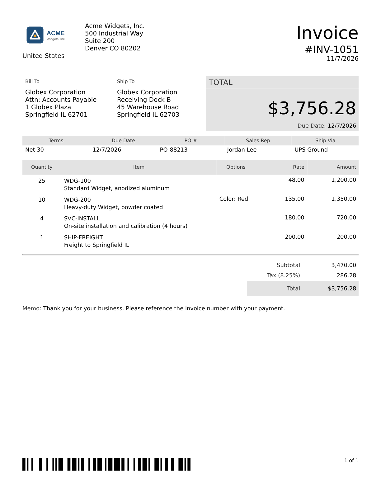

# NetSuite PDF Template Viewer

Edit NetSuite **Advanced PDF/HTML templates** locally and see the result immediately, without
uploading to NetSuite and printing a record for every change.

- Real **Apache FreeMarker 2.3.34** (the same engine NetSuite uses) renders the template, so syntax,
  built-ins (`?string.currency`, `?keep_before`, `#list`, macros…) and error messages match.
- The BFO `<pdf>` dialect NetSuite expects (`<macrolist>`, `nlheader`/`nlfooter`, `<pbr/>`,
  `<barcode/>`, `<pagenumber/>`, `size="Letter"`, `header-height="10%"`, …) is translated to HTML
  and printed with headless Chromium for real page breaks, repeating headers/footers and page numbers.
- Browser UI with a CodeMirror editor, live HTML preview, exact PDF page preview and
  live reload when files change on disk. A CLI renders PDF/PNG for scripted checks and for Claude.



## Requirements

| Tool | Why |
| --- | --- |
| Node.js 20+ | server, CLI, UI |
| Java 17+ (JDK, `javac` on PATH) | runs FreeMarker. `brew install openjdk` / `apt install default-jdk` |
| Chromium via Playwright | PDF output. `npx playwright install chromium` once per machine (already present in Claude cloud sessions) |

## Setup

```bash
cd netsuite-pdf-viewer
npm install          # also downloads the FreeMarker jar, compiles the engine, bundles the UI
npm start            # http://localhost:3000
```

`npm install` runs `npm run build`, which fetches `freemarker-2.3.34.jar` from Maven Central into
`engine/lib/` and compiles `engine/FtlServer.java`. Re-run `npm run build` if you change the Java file.

## Workflow

1. Put your template in `templates/` (export it from NetSuite: Customization > Forms > Advanced PDF/HTML
   Templates > Edit > Source). Any `.ftl`, `.xml` or `.html` file is listed.
2. Put sample record data in `samples/<name>.json` (see below).
3. Open the UI, pick the template and sample, edit either side. The preview re-renders as you type.
   **Ctrl/Cmd+S** saves to disk, **Ctrl/Cmd+Enter** re-renders.
4. Switch to **PDF (exact pages)** to see real page breaks, headers/footers and page numbers,
   or click **Download PDF**.
5. Paste the template source back into NetSuite when it looks right.

Edits made on disk by another tool (your IDE, or Claude in this repo) are picked up automatically:
the editor reloads the file if it has no unsaved changes, otherwise it offers a Reload button.

### Command line

```bash
npm run render -- templates/invoice.ftl samples/invoice.json            # -> out/invoice.pdf
npm run render -- templates/invoice.ftl samples/invoice.json --png      # also out/invoice-1.png, -2.png ...
npm run render -- templates/invoice.ftl samples/invoice.json --html     # also the converted print HTML
npm run render -- templates/invoice.ftl samples/invoice.json --lenient  # keep going past missing fields
```

Exit code 2 and a FreeMarker message with line/column when the template has an error, so it works in
scripts and lets Claude check a template without a browser.

### HTTP API (used by the UI)

| Method | Path | Notes |
| --- | --- | --- |
| GET | `/api/files` | lists templates, samples, assets, engine version |
| GET / PUT / DELETE | `/api/templates/:name`, `/api/samples/:name` | read/write files (PUT body is the raw text) |
| POST | `/api/render` | `{ template | templateName, sample | sampleName, mode: "html" | "pdf" | "source", lenient }` |
| GET | `/events` | server-sent events for file changes |

## Sample data format

A sample file is the FreeMarker data model: the same objects NetSuite passes to the template
(`record`, `companyInformation`, `subsidiary`, `preferences`, `salesTaxItem`, …). Keys starting with `@`
configure the viewer and are stripped before rendering:

```jsonc
{
  "@labels":  { "tranid": "Invoice #", "custbody_po": "Customer PO" },   // ${record.tranid@label}
  "@assets":  { "media.nl?id=1234": "logo.svg" },                       // NetSuite image URL -> assets/ file
  "@options": { "locale": "en_US", "dateFormat": "M/d/yyyy", "numberFormat": "number",
                "lenient": false, "preserveNewlines": true },
  "companyInformation": { "companyName": "Acme Widgets, Inc.", "logoUrl": "https://....media.nl?id=1234", "addressText": "..." },
  "record": {
    "@title": "Invoice",                 // ${record@title}
    "tranid": "INV-1051",
    "trandate": "2026-11-07",            // ISO date strings become real dates (so ?string("MM/dd/yyyy") works)
    "total": "$3,756.28",                // NetSuite passes most amounts pre-formatted as strings
    "item": [ { "item": "WDG-100", "quantity": "25", "rate": "48.00", "amount": "1,200.00" } ]
  }
}
```

- Field labels come from `@labels`, falling back to a built-in list of common NetSuite labels and then to a
  humanised field id.
- Images: NetSuite file-cabinet URLs cannot be fetched from outside NetSuite. Map them in `@assets`
  (matched by substring) to a file in `assets/`; unmapped NetSuite URLs render as a placeholder box and a warning.
  Relative `src` values are looked up in `assets/` too.
- Fonts: `<link type="font" name="NotoSans" src="${nsfont.…}">` becomes an `@font-face` rule that uses a locally
  installed Noto Sans / DejaVu Sans / Liberation Sans / Arial. Drop real `.ttf` files in `assets/` and point
  `src` at them to match NetSuite exactly.

## What is emulated, and what is not

| NetSuite / BFO feature | Viewer |
| --- | --- |
| FreeMarker syntax, built-ins, `#setting`, `.now`, `.locale` | real FreeMarker, identical |
| `${field@label}`, `${record@title}` | rewritten; values from `@labels` / `@title` |
| `nsfont.*` | any key resolves (placeholder URL), mapped to local fonts |
| `<body size padding header header-height footer footer-height>` | page size, margins, header/footer areas |
| `<macrolist>` / `<macro id>` used as header/footer | Chromium header/footer templates on every page |
| `<pagenumber/>`, `<totalpages/>` | inside header/footer macros only (as in NetSuite); elsewhere shown as `#` |
| `<pbr/>` | page break |
| `<barcode codetype value showtext>` | code128, code39, code93, ean13/8, upca/e, qrcode, datamatrix, pdf417, itf, codabar, postnet |
| CSS-named attributes (`line-height="150%"`, `background-color="…"`) | converted to inline style |
| Newlines inside text (multi-line addresses) | converted to line breaks, as BFO does |
| `<pdfset>` with several `<pdf>` | concatenated with page breaks; first document's header/footer only |
| Exact BFO layout quirks (table column algorithm, font metrics) | Chromium's layout; expect small differences |
| `<#include>` of other NetSuite templates, SuiteScript-provided variables | not available; add the data to the sample |

Warnings for anything that could not be emulated are shown above the preview and printed by the CLI.

## Using it from Claude

Claude can edit `templates/*.ftl` and `samples/*.json` directly, run
`npm run render -- templates/x.ftl samples/x.json --png` to look at the result, and send you the PNG/PDF.
With `npm start` running, every edit also appears live in the browser UI.

## Project layout

```
engine/FtlServer.java   FreeMarker sidecar (JSON lines over stdin/stdout), built by engine/build.sh
src/ftl.js              spawns/pools the sidecar
src/netsuite.js         @label/@title rewriting, sample model defaults
src/bfo.js              BFO dialect -> printable HTML (+ header/footer templates, page geometry)
src/pdf.js              Playwright/Chromium PDF + PNG
src/render.js           pipeline used by the server and CLI
src/server.js           express API, SSE live reload, static UI
src/cli.js              npm run render
ui/editor.js            CodeMirror bundle source (built to public/vendor/)
public/                 browser UI
templates/, samples/, assets/, out/
```

`npm test` runs the unit tests (converter, NetSuite rewriting, units) and an end-to-end render through the
real engine when Java is available.
